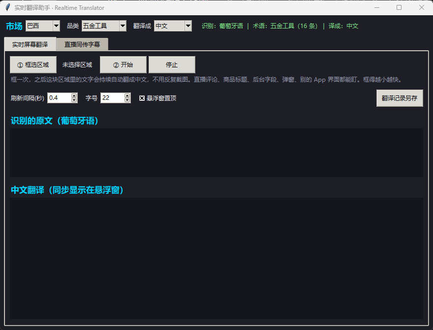
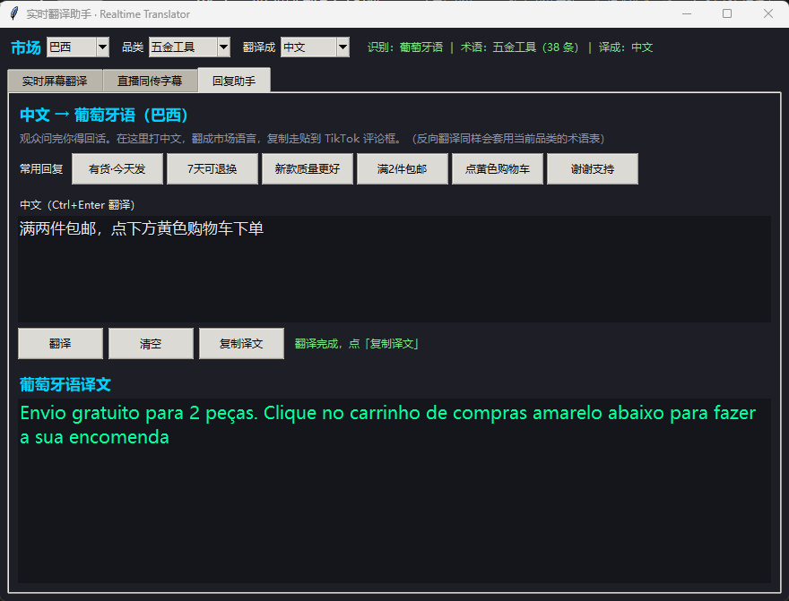

# 实时翻译助手 · Realtime Translator

**A real-time screen & audio translator for cross-border sellers — built for TikTok Shop in Brazil / Mexico / Argentina / US.**
It does two things on one Windows screen, fully local, **no API key required**:

1. **屏幕实时翻译** — draw a box over any part of the screen (live comments, product title, seller backend, pop-ups) and it keeps translating that region automatically. No repeated screenshots.
2. **直播同传字幕** — capture system audio (WASAPI loopback, no microphone needed), transcribe with Whisper, and show live subtitles. Exports an `.srt` for your recording.
3. **回复助手** — 观众问完你得回话：打中文，翻成市场语言，一键复制去回评。反向翻译同样套用品类术语表。

Built for people who sell in Latin America but can't read Portuguese or Spanish. **Windows only, Chinese UI.**

> ⚠️ Not affiliated with, endorsed by, or connected to TikTok / TikTok Shop / ByteDance.
> ⚠️ 使用前请先读 [许可证与免责声明](#许可证与免责声明)：**默认只用在线接口**；可选的本地离线模型
> NLLB 是 **CC-BY-NC-4.0（禁止商用）**，只有你主动切到本地模式时才会启用。



---

## 目录

- [它解决什么问题](#它解决什么问题)
- [快速开始](#快速开始)
- [多市场与品类](#多市场与品类)
- [实测数据](#实测数据)
- [踩过的坑（这个项目真正的价值）](#踩过的坑这个项目真正的价值)
- [文件说明](#文件说明)
- [常见问题](#常见问题)
- [已知限制](#已知限制)
- [许可证与免责声明](#许可证与免责声明)

---

## 它解决什么问题

做拉美市场最大的日常障碍不是选品，是**看不懂**：直播间的评论一直在刷、后台字段全是葡语/西语、
供应商发来的资料要一句句查。而现成的方案都有硬伤：

| 方案 | 问题 |
|---|---|
| 手机自带翻译 / 微信截图翻译 | 一次只能翻一屏，评论是流动的，跟不上 |
| 浏览器翻译插件 | 只对网页生效，管不了投屏的手机界面和直播评论 |
| Windows 实时字幕 + LiveCaptions Translator | 需要装语言包，且只做音频、不做屏幕文字 |
| 付费翻译 API | 要 Key、要计费、有延迟 |

这个工具把**屏幕文字**和**系统声音**两条实时通路放在一个窗口里，全部本地运行。

## 三个功能

### 1. 实时屏幕翻译

框一次区域，之后这块区域里的文字**一变就自动翻译**，结果显示在一个可拖动的悬浮窗里。

- 适合：直播评论区（最有价值）、商品标题、TikTok Shop 后台字段、弹窗提示、供应商资料
- 不是"截图翻译"：不需要反复截图、不需要切换窗口
- 框得越小越快（一次识别约 1.3 秒）
- 悬浮窗挡住下面的界面点不到时，勾「**鼠标穿透**」让点击穿过去（关闭请回主窗口取消勾选）

### 2. 直播同传字幕

抓系统声音 → Whisper 识别 → 实时中文翻译 → 悬浮窗显示，并自动写 `记录\直播字幕.srt`。

- 录的是**系统声音回环**，不占麦克风、不用开"立体声混音"
- 靠声音停顿自动断句，**说完一句就出字幕**（不是固定等几秒）
- 字幕文件可以直接给直播录像压字幕（PotPlayer / VLC / 剪映 / PR）
- 界面实时显示 `识别x.xx + 翻译x.xx`，慢在哪一眼能看出来

### 3. 回复助手（中文 → 市场语言）

看懂只是一半，还得能回话。这个页签打中文 → 翻成当前市场的语言 → 一键复制，直接贴到 TikTok 评论框。

- 方向跟着**市场**走：巴西出葡语、墨西哥出西语、美区出英语
- 带 6 条常用回复预设（有货·今天发 / 7天可退换 / 新款质量更好 / 满2件包邮 / 点黄色购物车 / 谢谢支持）
- **术语会提前替换成目标语言的正确说法**，实测有效：

```
这把电动螺丝刀很耐用，配一个工具箱
  直译   -> Esta chave de fenda elétrica é durável e vem com uma caixa de ferramentas
  预替换后 -> Essa parafusadeira é muito resistente e vem com maleta        ← 术语都对
```



## 快速开始

### 环境要求

- **Windows 10 / 11（64 位）** —— 用了 WASAPI 回环录音，其他系统不支持
- **Python 3.12（64 位）** —— 必须正好 3.12，因为 `libs/` 里是 cp312 编译的二进制组件
- 可选：NVIDIA 显卡（有则自动用 GPU，没有也能跑，见[实测数据](#实测数据)）

### 安装

```powershell
# 1) 依赖装到项目内的 libs\ 目录，不污染系统 Python，国内网络也能用
python fetch_wheels.py --core

# 2) 识别模型（small 约 464 MB，日常够用）
python fetch_model.py small

# 3) 拉丁语系 OCR 模型（7.5 MB，必须，否则葡语重音会丢）
python fetch_ocr_model.py

# 4) 自检，确认环境就绪
python check_env.py
```

> 以上四步就够了。**本地离线翻译模型是可选的**：默认「仅在线接口」，不装任何翻译模型也能跑。
> 想要断网兜底再跑 `python fetch_nllb.py`（注意 NLLB 是 CC-BY-NC-4.0，禁止商用）。

### 启动

双击 **`启动翻译助手.bat`**，或者：

```powershell
python app.py
```

界面顶部先选 **市场 / 品类 / 翻译成**，再点页签里的「① 框选区域」→「② 开始」。

## 多市场与品类

设计原则：**市场决定说什么语言，品类决定用什么术语**，两者独立。

| 市场 | 识别语言 | 翻译源语言 |
|---|---|---|
| 巴西 | 葡萄牙语 | pt-BR |
| 墨西哥 | 西班牙语（拉美） | es-MX |
| 阿根廷 | 西班牙语（阿根廷用词） | es-AR |
| 美区 | 英语 | en-US |
| 自定义 | 沿用当前设置 | 沿用当前 |

品类术语表：五金工具 / 汽车与摩托 / 运动与户外 / 通用（不加载术语表）。

**加新市场或新品类只改一个文件**（`markets.py`）：

```python
MARKETS = {
    "哥伦比亚": {"locale": "es-CO", "whisper": "es", "nllb": "spa_Latn", "asr_prompt": "..."},
}
CATEGORIES = {
    "美妆个护": {"pt": {"batom": "口红", ...}, "es": {...}, "en": {...}},
}
```

术语表不是可有可无的装饰：在线接口把 `parafusadeira` 译成"螺丝刀"、把 `maleta` 译成"手提箱"是常态，
术语表把它们纠成"电动螺丝刀""工具箱"。

## 实测数据

全部在本机（RTX 3060 Ti）真实跑过，脚本都在 `tools\` 里可以复现。

### 识别速度 —— 没有独显也够用

16.8 秒西语语音：

| 模型 | 算力 | 识别耗时 | 实时率 | 每 3 秒音频 |
|---|---|---|---|---|
| small | GPU float16 | 0.29 s | 0.017x | 0.05 s |
| **small** | **CPU int8** | **1.77 s** | **0.105x** | **0.32 s** |
| medium | GPU float16 | 0.49 s | 0.029x | 0.09 s |
| medium | CPU int8 | 5.19 s | 0.308x | 0.88 s |

**结论：纯 CPU 跑 `small`，一句字幕 0.32 秒，加上翻译约 0.9 秒** —— 直播同传完全跟得上。
程序会自动判断：有 CUDA 用 GPU，没有就干净地走 CPU。

### 端到端延迟

| 环节 | 优化前 | 现在 |
|---|---|---|
| 字幕相对音频结束 | +2.9 ~ +9.6 秒 | **+0.50 秒（small）/ +0.60 秒（medium）** |
| 单句处理耗时 | 1.6 ~ 3.9 秒 | 0.91 秒（small）/ 1.38 秒（medium） |

### OCR 准确率 —— 换模型后字错率归零

| 用例 | 中文识别模型 | **拉丁语系模型** |
|---|---|---|
| 葡语 18pt | CER 0.1882 | **0.0000** |
| 葡语 14pt | CER 0.0667 | **0.0000** |
| 西语 18pt | CER 0.1055 | **0.0000** |
| 西语 14pt | CER 0.0312 | **0.0000** |

换模型只慢 46 毫秒（1304 ms → 1350 ms）。

### 用系统自带 OCR 再提速约 90~140 倍（装 pt-BR 语言包后）

同一张 900×420 的图，冷启动与稳定态分开测：

| 引擎 | 冷启动（含加载模型） | 稳定态每帧 | 葡语字错率 |
|---|---|---|---|
| 本地拉丁模型 | 3144 ms | **1288 ~ 1673 ms** | 0.0000 |
| **Windows 自带 OCR（pt-BR）** | 47 ms | **12 ~ 14 ms** | 0.0000 |
| | 快 66.7 倍 | **快约 90 ~ 140 倍** | 持平 |

界面「屏幕识别」三个选项：**自动**（语言包就绪就用系统 OCR，否则自动退回本地模型）/
系统 OCR（快）/ 本地模型（准）。装好语言包后保持「自动」即可，**不需要改代码**。

复现：`python tools\bench_ocr_speed.py`（冷/热两个口径）、`python tools\audit_winocr.py`（逐用例 CER + 耗时）。

> 早前 README/说明里写的「快 128 倍」，速度量级没错，但当时 `audit_winocr.py` 的
> 「拉丁模型」列没显式指定引擎 —— 语言包装好后默认 `auto` 会走 Windows OCR，
> 那一列在跟自己比。已修。

### 翻译通道

顺序按**实测质量**排（不是延迟），四个通道全部免 Key：

| # | 通道 | 术语命中率 | 中位延迟 | 持续调用可靠性 |
|---|---|---|---|---|
| 1 | 有道（`aidemo`） | 81% | 0.09 s | 突发限流（`errorCode 411`），约放行 6 次后拒绝，几十秒恢复 |
| 2 | MyMemory | 62% | 0.95 s | **每日配额**，用尽后 HTTP 429（实测 `Retry-After` 17917 秒）|
| 3 | 腾讯交互翻译（`transmart`） | 53% | 0.28 s | **65 次连续调用零失败** —— 唯一不限流的通道 |
| 4 | Google（`clients5`） | — | 6 s 超时 | 国内直连不可达，**必须挂代理**；仅在能用时作末位兜底 |

命中率口径：14 句含 38 个术语的葡语直播句式，过完术语表修正后的正确率（`tools/score_channels.py`）。

排序是被实测推翻后改的：最初按延迟排（有道→腾讯→MyMemory），压测后发现
**有道和 MyMemory 都会限流，只有腾讯扛得住** —— 所以把质量更好的两个放前面，
腾讯放第三做可靠性底线，Google 放最后（前面全挂才会轮到它，正常流程永远不白等那 6 秒）。

限流冷却不再固定 120 秒：有道 411 冷却 90 秒；MyMemory 直接读 `Retry-After`（夹在 30 秒 ~ 8 小时）。
否则配额耗尽后它每天会被白白重试几百次。

四个都是**非官方公开接口**，不需要 Key，但也随时可能失效。程序按顺序尝试，**并且带通道熔断**：
某个通道失败后冷却期内直接跳过，全部失败才降级到本地模型。

这条熔断不是锦上添花 —— 见下面第 6 个坑。

## 踩过的坑（这个项目真正的价值）

这些坑都花了不少时间才定位，写下来给后面的人省事：

**1. OCR 字典里根本没有葡语的重音字母**
`rapidocr_onnxruntime` 自带的是中文识别模型（6625 字字典），
`ã ç ê õ ñ â ¿` **一个都不在字典里**。结果 `São Paulo`、`preço`、`não` 全被认错，
18pt 时连**词间空格**都会丢（`Esse preço está ótimo` → `Esseprecoesta6timo`）。
换成拉丁语系识别模型（字典 502 字，含全部重音）后字错率直接归零。
**上游原文就是错的，翻译再准也救不回来。**

**2. "画面变了才识别"这个开关曾经完全失效**
原来的画面指纹是每格只采 **1 个像素**（17×17=289 格），要求 6% 的格子变化才重新识别。
但采样行间距 26 px、一行文字高 17 px，所以**一行文字最多只能影响 1 个采样行 = 17/289 = 5.88% < 6%**
—— 结构上单行变化永远触发不了。评论区没满、或者只改一行标题时，画面明明变了却不刷新。
改成块内取均值（32×16=512 格）+ 实测阈值，并加了"最多静默 3 秒强制识别一次"兜底。

**3. NLLB 用在 CTranslate2 上有两个必踩的坑**
- **必须用模型自己的 tokenizer**（`AutoTokenizer.from_pretrained`）。直接用裸 SentencePiece 会编码出错 token，
  模型退化成复读机：`welcome welcome welcome...`
- **`translate_batch` 必须传 `target_prefix=[[目标语言码]]`**。漏了会用"默认语言"输出，
  实测跑出过**巴斯克语**（`Kaixo, lagunak`）和**世界语**（`Hodiaŭ mi kunportis`）

**4. 术语修正会把已经译对的词改坏**
"把译错的词替换成标准说法"如果写成无边界 `out.replace()`，就会出这种事：
源句里同时有 `chave de fenda`（一字螺丝刀）和 `parafusadeira`（电动螺丝刀）时，
译文里的"一字螺丝刀"会被改成"一字电动螺丝刀"，"电动螺丝刀"变成"电动电动螺丝刀"。
修法是替换前先把当前术语表里**所有正确说法**保护起来（占位符），替换完再还原。

**5. 在线接口比本地小模型强得多**
同样 10 个五金术语，在线接口命中 9/10，NLLB-600M 只有 5/10。
所以顺序是**在线优先**，本地模型只在你主动切换后才参与 —— 默认根本不会碰本地模型。

**6. 一个通道被墙，能把整条链路拖死**（这个最坑）
Google 那条接口在国内时通时不通。不通时每次调用要白等超时，而字幕是**同步**翻译的，于是：

```
改前：每句字幕 9.04 / 9.27 / 9.15 秒   ← 每句都先等 Google 超时 6 秒再走兜底
改后：第 1 句 7.08 秒（只付一次），第 2 句起 1.23 ~ 1.40 秒，平均 2.47 秒
```

正常只要 0.1~1.6 秒的事，被一个不可达通道放大成 9 秒 —— 直播同传直接废掉。
修法是给通道加**熔断**：失败后一段时间内跳过它，同时把单次超时从 8 秒降到 6 秒。
（跑 `python tools\verify_e2e.py` 就会暴露这个问题：它每句的耗时一眼能看出异常。）

**7. 免费通道全都会限流，而且限流方式完全不同**（2026-10 压测发现）
原本按延迟把最快的有道排在第一位，压测后被打脸：

```
有道      零间隔 30 次 -> 成功 1/30       间隔 2 秒 15 次 -> 成功 6/15
MyMemory  跑一段时间后 -> HTTP 429 "YOU USED ALL AVAILABLE FREE TRANSLATIONS FOR TODAY"
腾讯      零间隔 20 次 -> 成功 20/20      65 次连续调用零失败
```

有道的失败响应是 `{"msg":"请求频率过快","errorCode":411}`，MyMemory 的 429 带着
`Retry-After: 17917`（近 5 小时）—— 一个是短时突发，一个是**每日**配额。
统一按 120 秒冷却的话，MyMemory 每天会被白白重试几百次。

结论：**顺序改成按质量排**（有道 → MyMemory → 腾讯 → Google），
腾讯虽然术语命中率最低（53% vs 有道 81%），但它是唯一不限流的通道，
放第三做长直播的可靠性底线。给腾讯的错译补了术语修正表，命中率从 29% 提到 53%。

## 文件说明

| 文件 | 作用 |
|---|---|
| `app.py` | 主程序（Tkinter 界面 + 两个功能） |
| `markets.py` | **市场与品类配置**（语言档案 + 多语术语表） |
| `asr_engine.py` | 语音识别引擎（faster-whisper + VAD 断句 + 术语提示词） |
| `live_caption.py` | 系统声音回环录音（WASAPI） |
| `screen_translate.py` | 屏幕 OCR（RapidOCR + 画面变化检测） |
| `translate_core.py` | 翻译调度（在线多通道 + 术语表 + 本地兜底） |
| `nllb_translate.py` | 本地离线翻译（CTranslate2） |
| `check_env.py` / `check_deploy.py` | 环境自检 / 换电脑部署自检 |
| `fetch_wheels.py` | 下载依赖到 `libs/`（`--core` 装核心包） |
| `fetch_model.py` | 下载识别模型 |
| `fetch_ocr_model.py` | 下载拉丁语系 OCR 模型 |
| `fetch_nllb.py` | 下载本地翻译模型 |
| `start.ps1` / `启动翻译助手.bat` | 启动脚本（.bat 只负责转交，中文路径交给 PowerShell） |
| `settings.json` | 记住上次的选择（市场/品类/目标语言/模型/引擎/区域等，不提交） |
| `tools\` | **审计与验收脚本**（`verify_p0.py` / `verify_channels.py` / `score_channels.py` / `check_termfixes.py` / `audit_ocr_latin.py` / `bench_cpu_gpu.py` 等），README 里每个实测数字都能在这儿复现 |
| `tmp\` | 模型与缓存的落盘目录（约 2.5 GB，**不提交**） |
| `记录\` | 翻译记录与 `.srt` 字幕输出（不提交） |

## 常见问题

| 现象 | 处理 |
|---|---|
| 双击 bat 一闪而过 | 右键 `start.ps1` → 使用 PowerShell 运行，会停在窗口里显示报错 |
| 提示 Python 版本不对 | 装 64 位 Python 3.12（`libs/` 是 cp312 编译的） |
| 提示找不到 numpy | 依赖没装：`python fetch_wheels.py --core` |
| 听译没反应 | 确认电脑扬声器在响（回环录的是扬声器输出）；`python check_deploy.py` 看回环那项 |
| 屏幕翻译不更新 | 先确认已点「开始」；重新框一次区域（框太大或太偏会识别不到） |
| 换电脑怎么弄 | 见 `部署到另一台电脑.md`，先跑 `python check_deploy.py` |
| 翻译偶尔空一下 | 免费接口偶尔限流，程序会自动换通道重试 |

## 已知限制

- **只支持 Windows**（WASAPI 回环、mss 抓屏都是 Windows 方案）
- **界面是中文**，代码注释也是中文
- **一句话里同时出现两个近义工具名时无法区分**：`chave de fenda` 和 `parafusadeira` 若被在线接口都译成"螺丝刀"，
  术语表无法按位置还原（正确做法是翻译前替换成占位符、译后按位置还原，尚未实现）
- **术语表是人工维护的**：加新品类需要自己填核心术语，填 20 个词效果就很明显
- **屏幕翻译用本地 OCR 时一帧约 1.3 秒**：装 Windows 语言包换成系统 OCR 可降到 **12~14 毫秒**（详见上面的对比表）
- 在线翻译通道是**非官方接口**，Google 那条在中国大陆通常不可达（会自动换 MyMemory / 有道 / 腾讯）

## 许可证与免责声明

**代码**：[MIT](LICENSE)

**依赖**：全部是宽松许可（MIT / BSD / Apache-2.0 / MPL-2.0 / PSF），没有 GPL / AGPL。

**模型**（运行时下载，不随仓库分发）：

| 模型 | 许可证 | 能否商用 | 本项目怎么用 |
|---|---|---|---|
| `Systran/faster-whisper-small` / `medium` | MIT | ✅ | 语音识别，默认 |
| `monkt/paddleocr-onnx`（拉丁 OCR） | Apache-2.0 | ✅ | 屏幕 OCR，默认 |
| `facebook/nllb-200-*` | **CC-BY-NC-4.0** | ❌ **禁止商用** | 可选的离线翻译兜底（`fetch_nllb.py`） |
| `facebook/m2m100_418M` | MIT | ✅ | **评估过，未采用**（见下） |

> ⚠️ **NLLB-200 全系是 NonCommercial 许可。** 它在本项目里只是**第三级兜底**：
> 在线接口全部失败、或你主动选「仅本地模型」时才会用到。
> `fetch_nllb.py` 是**手动运行**的，不跑它就完全没有本地模型，程序照常工作；
> 跑了之后它会在在线接口全部失败时自动兜底。商用场景请自行评估许可。

**关于「换一个可商用的本地模型」**：我实测评估过 MIT 许可的 `facebook/m2m100_418M`
（CTranslate2 int8，467 MB），**结论是不采用**。用 6 个核心工具术语打分：

| 引擎 | 术语命中率 | 每句耗时（GPU） |
|---|---|---|
| **在线接口** | **6/6** | 0.1 ~ 1.6 s |
| **在线接口 + 术语表** | **6/6** | 同上 |
| NLLB-200 600M（现用兜底） | 5/6 | 0.26 s |
| M2M-100 418M | **0/6** | 0.23 s |
| M2M-100 418M + 术语表 | **0/6** | 同上 |

M2M-100 的输出实例（都不是个别现象，是系统性的）：

```
原文: Hoje eu trouxe uma parafusadeira muito potente.
M2M:  今天,我拿到了一个非常强大的<unk>子。      ← parafusadeira 直接变 <unk>
原文: Pessoal, olha como esse alicate é resistente...
M2M:  个人,看看这种<unk>是多么的耐用...          ← alicate 又是 <unk>
原文: Essa furadeira vem com maleta completa...
M2M:  这款电池配备了全包、12V电池和快速充电器。   ← furadeira 整句丢了，maleta→"全包"
原文: Las balatas y el aceite lubricante son originales.
M2M:  香水和油是原始的。                        ← 刹车片 → 香水
```

速度上也没优势（0.23 s vs NLLB 的 0.26 s），所以没有理由换。

顺带确认了 M2M-100 有和 NLLB **完全一样的 `target_prefix` 坑**：不带目标语言前缀时，
它会输出**加利西亚语**（`Hoxe trouxo unha peza moi poderosa.`）而不是中文。

评估脚本和原始结果保留在 `tools\m2m_probe.py`、`tools\m2m_probe_result.json`，可以自己复跑。
补充两点实测细节：把 `beam_size` 从 2 提到 5（模型自带 `generation_config` 建议值）几乎没改善；
语言 token id 与 CT2 词表是逐一对齐的（`__zh__`=128102 等），所以这不是简单的 id 错位问题 ——
M2M-100 在 pt→zh 这种低资源方向上本来就远弱于 NLLB。

**其它**：

- 四个在线翻译通道（有道 `aidemo` / MyMemory / 腾讯 `transmart` / Google `clients5`）都是**非官方公开接口**，随时可能变更或失效。其中只有腾讯不限流，另外三个长时间直播都会触发限流。
  用它们等于把待翻译文本发给了第三方，介意的话请切到本地模型（界面上选「仅本地模型」，
  需先 `python fetch_nllb.py`，并注意其 NC 许可）。
- 本项目**不包含也不分发** iPhoneMirror 等投屏软件，仅与其配合使用。
- 屏幕 OCR 会把屏幕内容发送给翻译接口（如果用的是在线通道）。涉及敏感信息的画面请切到「仅本地模型」。
- 本项目与 TikTok / TikTok Shop / ByteDance 无任何关联。
